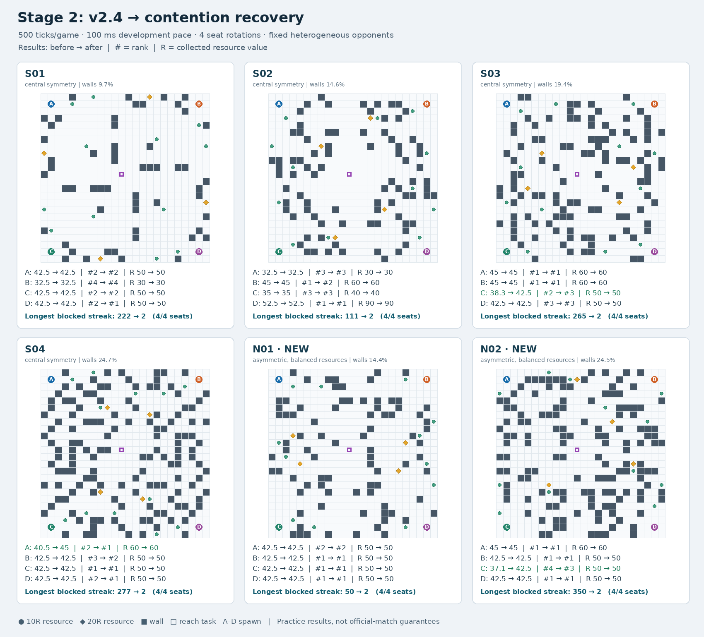

# 远端更新与二阶段效果测试报告

> 发布附件：[精简结果](results/stage2-contention-review-20261030/no-ai-summary.json)、[地图](results/stage2-contention-review-20261030/maps-no-ai.png)、[正式默认关闭启动核验](results/stage2-contention-review-20261030/default-off-entry-checks.json)。完整原始日志留在本地，未随提交上传。当前正式配置已按用户要求关闭通用争格恢复，以下保留当时前后对照的测试结果。

日期：2026-10-30（Asia/Shanghai）。仓库由`4d632d39c8e60610a761cf0e2e9a71c00b3176ad`快进至`474d0f4fbbb46de536f4bfa8322d41b6d1350883`，提交标题为`feat(stage2): add contention recovery candidate on v2.4`。保留了原有未跟踪文档，没有提交或推送本轮实验文件。

## 1. 更新内容与本轮实际操作

本次仅更新二阶段：新增通用移动争格恢复，正式`stage2/config/final.yaml`把`movement_blocked_recovery`设为true；原52项配置逐项保留。一阶段`src/rmtc_bot`、一阶段入口与AI客户端未改变。

新机制必须收到本车同一移动边连续两次`E_BLOCKED`，才暂时冷却该有向边4–6Tick；主寻路、局部资源恢复和最终动作候选都遵守冷却。不会把临时争格写成永久障碍，不删除资源；反方向和其他进入该格的边不自动禁用。必要时在已见空邻格里选择退让，给选中方向0.8局部奖励，仍保留原攻防评分。

缺帧、换场、死亡、无法解释的位移和同Tick提案歧义会清理或撤销失败证据；后到幻术解释若改变历史物理方向，也会撤销旧证据。遇到已知致命事件时，若冷却边是唯一已知非致命出口，可以恢复该出口资格。冷却等待不会延长TTL，到期允许重试。

更新前源码已在独立目录保存并重建，更新后正式二阶段包也已重建。所有被测本车均经过各自`run_contestant.sh <席位> 2`正式入口；核对最终进程实际可执行文件哈希，并通过ROS服务逐项核对参数和话题接口。没有为了调参修改正式策略源码，本轮新增代码仅属于隔离评测/组件检查/报告工具。

| 版本 | 二进制SHA-256 |
| --- | --- |
| 更新前v2.4独立重建 | `eb025df2d83f8751c66ca777ae8cee1396fbdb1130ff5ab7cb9fedc82b55812a` |
| 更新后候选正式构建 | `e154b18cb8da971bc2a282c57dab7172bc0530282dbac21401a73b8e656b0d97` |

## 2. 测试设计与有效性

主对照为6图×4席位×前后两版=48局，每局500Tick、100ms开发节奏。本车轮流占A/B/C/D，三个对手固定为开局探索、防御、压力三种异质策略，二进制及参数不变。主对照关闭事件与AI，隔离新争格机制；没有真实模型费用，也不验证正式模型任务资格。

四张既有中心对称图S01–S04覆盖约10%–25%障碍；另在看结果前固定生成两张新非中心对称图N01/N02，种子2026103001/2026103002。新图每个出生区域都是3普通+1高价值、独占最近资源50R，最近普通/高价值距离3/12，四资源站距离和33，收集本区四资源的最短访问长度差不超过2步。生成器及地图只给测试环境使用，参赛程序只收本车合法感知，阶段间/场次间独立清图。

补充4局500ms正式节奏：S03四车同版本更新前/后各1局；再将主对照中已观察到的S03-C增分且掉名次案例，按原异质对手条件前/后各复核1局。这是机制复核，不把重复地图当新独立样本，亦不与主对照混算胜率。

52局全部完整有效：208份四车接口与实际参数核对、104000条本车决策，所有车0–499决策完整，末回执覆盖Tick499及Tick500终局结算；零非法动作、零感知拒绝、零缺帧或回执类型/Tick错配。排名按最终总分、任务数、R、调整D和无效动作比较，严格第一排除同键并列。得分取最终500Tick榜单，不用Tick499自估冒充终局。

## 3. 主对照结果（24个地图/席位配对）

| 指标 | 更新前v2.4 | 更新后 | 变化 |
| --- | ---: | ---: | ---: |
| 平均总分 | 41.7042 | 42.2917 | +0.5875 |
| 平均资源R | 51.6667 | 51.6667 | +0.0000 |
| 平均完成任务数 | 2.8750 | 2.8750 | +0.0000 |
| 平均调整D | 974.44 | 1113.12 | +138.6806 |
| 平均名次（越小越好） | 1.8750 | 1.7500 | -0.1250 |
| 前二局数 | 18 | 18 | +0.0000 |
| 严格第一局数 | 11 | 13 | +2.0000 |
| 每局平均死亡次数 | 8.5833 | 9.7083 | +1.1250 |
| 单局最高P95决策耗时ms | 1.6410 | 1.6524 | +0.0114 |
| E_BLOCKED回执总数 | 1696 | 88 | -1608 |
| 同一边最长连续受阻 | 350 | 2 | -348 |
| 死亡总次数（自HP/存活记录） | 206 | 233 | +27 |

24对中15对轨迹改变；总分3升、0降、21平；名次5升、2降、17平。受阻数包含末Tick499动作在500终局的回执。死亡按相邻本车存活→死亡计数，不把D下降直接当死亡；该口径可能不覆盖未单独发布死亡帧的立即复活。

### 按地图汇总

| 地图 | 对称性 | 平均分 前→后 | 平均R 前→后 | 平均名次 前→后 | 严格第一 前→后 | 最长受阻 前→后 |
| --- | --- | ---: | ---: | ---: | ---: | ---: |
| S01 | 中心对称 | 40.000→40.000 | 45.00→45.00 | 2.50→2.25 | 0→1 | 222→2 |
| S02 | 中心对称 | 41.250→41.250 | 55.00→55.00 | 2.00→2.25 | 2→1 | 111→2 |
| S03 | 中心对称 | 42.700→43.750 | 55.00→55.00 | 1.75→2.00 | 2→2 | 265→2 |
| S04 | 中心对称 | 42.000→43.125 | 52.50→52.50 | 2.00→1.25 | 1→3 | 277→2 |
| N01 | 新非中心对称 | 42.500→42.500 | 50.00→50.00 | 1.25→1.25 | 3→3 | 50→2 |
| N02 | 新非中心对称 | 41.775→43.125 | 52.50→52.50 | 1.75→1.50 | 3→3 | 350→2 |

### 逐地图/席位结果

| 案例 | 得分 前→后 | R 前→后 | M 前→后 | 名次 前→后 | D 前→后 | 最长受阻 前→后 | 退让提案/执行成功 |
| --- | ---: | ---: | ---: | ---: | ---: | ---: | ---: |
| N01-A | 42.5→42.5 | 50→50 | 3→3 | 2→2 | 1125→1125 | 0→0 | 0/0 |
| N01-B | 42.5→42.5 | 50→50 | 3→3 | 1→1 | 1380→1580 | 50→2 | 3/3 |
| N01-C | 42.5→42.5 | 50→50 | 3→3 | 1→1 | 1535→1535 | 0→0 | 0/0 |
| N01-D | 42.5→42.5 | 50→50 | 3→3 | 1→1 | 1220→1160 | 4→2 | 6/6 |
| N02-A | 45→45 | 60→60 | 3→3 | 1→1 | 995→995 | 0→0 | 0/0 |
| N02-B | 42.5→42.5 | 50→50 | 3→3 | 1→1 | 1420→1420 | 0→0 | 0/0 |
| N02-C | 37.1→42.5 | 50→50 | 3→3 | 4→3 | 320→670 | 350→2 | 1/1 |
| N02-D | 42.5→42.5 | 50→50 | 3→3 | 1→1 | 1430→1430 | 0→0 | 0/0 |
| S01-A | 42.5→42.5 | 50→50 | 3→3 | 2→2 | 1050→1050 | 0→0 | 0/0 |
| S01-B | 32.5→32.5 | 30→30 | 2→2 | 4→4 | 620→680 | 222→2 | 5/5 |
| S01-C | 42.5→42.5 | 50→50 | 3→3 | 2→2 | 1270→1440 | 11→2 | 1/1 |
| S01-D | 42.5→42.5 | 50→50 | 3→3 | 2→1 | 1190→1135 | 13→2 | 1/1 |
| S02-A | 32.5→32.5 | 30→30 | 2→2 | 3→3 | 620→700 | 37→2 | 4/4 |
| S02-B | 45→45 | 60→60 | 3→3 | 1→2 | 790→860 | 111→2 | 1/1 |
| S02-C | 35→35 | 40→40 | 2→2 | 3→3 | 660→660 | 16→2 | 3/3 |
| S02-D | 52.5→52.5 | 90→90 | 3→3 | 1→1 | 990→990 | 0→0 | 0/0 |
| S03-A | 45→45 | 60→60 | 3→3 | 1→1 | 860→1390 | 35→2 | 6/6 |
| S03-B | 45→45 | 60→60 | 3→3 | 1→1 | 1430→1430 | 0→0 | 0/0 |
| S03-C | 38.3→42.5 | 50→50 | 3→3 | 2→3 | 360→560 | 265→2 | 1/1 |
| S03-D | 42.5→42.5 | 50→50 | 3→3 | 3→3 | 620→720 | 14→2 | 1/1 |
| S04-A | 40.5→45 | 60→60 | 3→3 | 2→1 | 350→1250 | 277→2 | 1/1 |
| S04-B | 42.5→42.5 | 50→50 | 3→3 | 3→2 | 750→1175 | 24→2 | 2/2 |
| S04-C | 42.5→42.5 | 50→50 | 3→3 | 1→1 | 1645→1645 | 0→0 | 0/0 |
| S04-D | 42.5→42.5 | 50→50 | 3→3 | 2→1 | 756.667→1115 | 73→2 | 7/7 |

## 4. 500ms节奏复核

四车同版本S03：

| 席位 | 得分 前→后 | R 前→后 | D 前→后 | 名次 前→后 |
| --- | ---: | ---: | ---: | ---: |
| A | 42.5→42.5 | 50→50 | 1250→1250 | 3→3 |
| B | 42.5→42.5 | 50→50 | 1410→1410 | 2→2 |
| C | 41.6→41.6 | 50→50 | 470→470 | 4→4 |
| D | 42.5→42.5 | 50→50 | 1770→1770 | 1→1 |

该场前后四车的动作、位置、资源、D与任务轨迹哈希全部相同：True；未出现连续两次争格，因此它只提供正式节奏的同版本行为回归，不能据此证明该条件下脱困收益。

已触发案例S03-C，异质对手复核：

| 版本 | 得分 | R | D | M | 名次 | 最长受阻 | 与100ms相同版本轨迹一致 |
| --- | ---: | ---: | ---: | ---: | ---: | ---: | --- |
| pace-before | 38.3 | 50 | 360 | 3 | 2 | 265 | True |
| pace-after | 42.5 | 50 | 560 | 3 | 3 | 2 | True |

## 5. 实现边界检查与关闭开关一致性

- 现有151个GTest用例通过：137核心+14本地HTTP；colcon另统计2个CTest容器，总摘要153项，无错误/失败/跳过。
- 新增16项独立组件状态检查通过：两次同边失败、关闭开关、非E_BLOCKED错误、缺回执、跳Tick、成功移动重置、同Tick不重复消费、非移动不延长TTL、换场、死亡/复活、异常位移、后到幻术撤证、同Tick提案歧义、无出口合法动作、唯一事件出口、当前交战使后续事件致命。
- 评测器已有10项完整性审计检查通过。
- 8份更新前本车完整日志共4000帧，旧核心和新核心关闭movement开关分别重放；合计8000次动作/目标/原因比较，均零差异。它证明这批历史状态上的禁用一致性，不是另8000局实战，也不是所有输入的形式化等价证明。
- 组件初次有两条断言过严，要求无出口时只能wait；原策略允许attack或wait，实际选空射也合法。本轮仅修正实验断言为合法非移动，初次结果保留在movement-component-initial.json，没有为消除这两条失败修改正式程序。

## 6. 结果解释与边界

新机制首先解决长期重复争同一空落点，而不是增加资源权重。应分别看受阻下降、最终得分、排名和死亡，不能把空转减少的Tick直接换算成新增分数。超过500的D不再增加对抗分，但仍影响同分比较；解锁对局还可能同时帮助其他车完成任务或积累D，因此本车得分上升也可能掉名次。

S03-C是具体反例：开发节奏下本车38.3→42.5，R50和M3不变，D360→560，但名次2→3。原来与本车一起受限的其他车也得到了更多任务/战斗机会。这个事实不支持“只要解除卡死就一定提高名次”。

本次主样本仅6图、冻结异质对手；新图只有2张。没有完整事件实战、真实LLM或正式任务资格测试，事件交互证据来自组件状态检查。500ms已触发复核使用主对照中事后选出的同一案例，不增加独立样本量。地图图表和全局榜单只用于测试评价，从未作为参赛车决策输入。

### 本轮判断

同边最长连续受阻从350降至2Tick，受阻回执总数从1696降至88，说明它在本批地图和对手下确实消除了长时间重复撞同一条边。平均总分41.7042→42.2917，平均名次1.8750→1.7500，但只有3个配对增分，2个配对名次下降。

资源R和完成任务数在全部24个配对中均不变，额外收益主要来自解锁后的战斗；死亡总数206→233，不能把它解释为生存能力提升。该补丁适合作为消除长时间争格的基础修复，后续应优先评估脱困后的目标选择和交战收益，尤其关注D达到计分上限后继续追击带来的死亡及排名影响，再单独验证有事件和LLM条件下的完整对局。

## 7. 证据位置

- 预先固定的地图/席位/节奏与二进制指纹（本地档案：`experiments/remote-update-20261030/plan.json`）
- 两张新图的对称性与资源/到达公平性审计（本地档案：`experiments/remote-update-20261030/maps-new-audit.json`）
- 更新后完整核心/本地HTTP回归日志（本地档案：`experiments/remote-update-20261030/candidate-tests.log`）
- 16项组件检查（本地档案：`experiments/remote-update-20261030/reports/movement-component.json`）
- 关闭开关的本车日志一致性（本地档案：`experiments/remote-update-20261030/reports/disabled-replay.json`）
- 24配对详细结果与逐车指标（本地档案：`experiments/remote-update-20261030/reports/progress-summary.json`）
- 500ms四车同版本结果（本地档案：`experiments/remote-update-20261030/reports/selfplay-summary.json`）
- 500ms已触发案例复核（本地档案：`experiments/remote-update-20261030/reports/pace-summary.json`）

收尾审计见closure-audit.json（本地档案：`experiments/remote-update-20261030/reports/closure-audit.json`）。每局原始证据在/home/miraculy/docker/ros2/contestant_ws/experiments/remote-update-20261030/runs（本地档案：`experiments/remote-update-20261030/runs`），包含config、可执行文件指纹、接口、实际参数、本车日志、终局状态及裁判结算。主评测和组件工具保存在/home/miraculy/docker/ros2/contestant_ws/experiments/remote-update-20261030/tools（本地档案：`experiments/remote-update-20261030/tools`）。本轮测试进程已全部退出，保留了原先与本轮无关的裁判服务。
