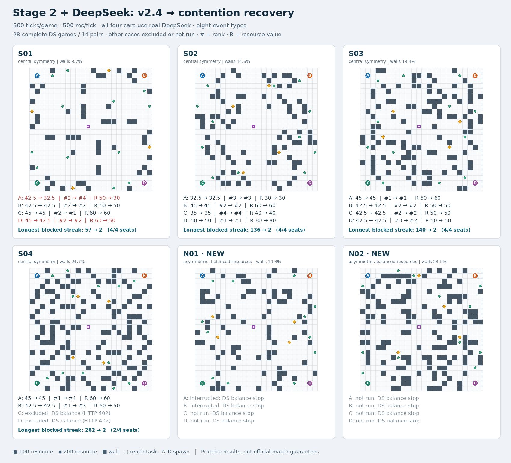

# 四车DeepSeek二阶段更新对照：已有结果与余额中断说明

> 发布附件：[精简结果](../results/stage2-contention-review-20261030/deepseek-summary.json)、[地图](../results/stage2-contention-review-20261030/maps-deepseek.png)、[正式默认关闭启动核验](../results/stage2-contention-review-20261030/default-off-entry-checks.json)。完整原始日志留在本地，未随提交上传。当前正式配置已按用户要求关闭通用争格恢复，以下保留当时前后对照的测试结果。

日期：2026-10-30。更新前`4d632d39c8e60610a761cf0e2e9a71c00b3176ad`，更新后`474d0f4fbbb46de536f4bfa8322d41b6d1350883`。用户要求接入DS测试，后因余额不足明确选择“先汇总已有结果”，本轮已停止，不自动续跑。正式源码、配置、入口未额外修改。

## 结论

本批正常DS条件下，争格恢复明显减少了连续受阻，但没有复现上一轮关闭AI/事件时的平均得分收益。14组配对中，得分0升、2降、12平；名次2升、2降、10平。平均分42.6786→41.7857，平均名次2.0000→2.1429。两版正式本车所有112个事件窗口都提前获得了参数匹配的解释，暂不支持将主结果归因于正式本车的模型失败或迟到。

这些是独立真实请求下的运行结果：模型返回内容、网络延迟与同Tick回调先后仍可能变化，不能把所有分差全归因于一个策略开关。反过来，也不能因有模型波动而删除掉分案例。

## 测试范围与中断

原计划6图×4席位×前后两版=48局，500Tick/局、500ms/Tick，4场并行。四车均连接真实`deepseek-flash`、关闭思考、temperature=0，经裁判代理访问DS，选手仅持各自practice令牌。主车使用各版本正式`run_contestant.sh <席位> 2`；三个冻结对手沿用开局探索、防御、压力策略。原八类事件开启，预告保持5Tick，没有延长窗口。地形、资源、席位、模型及配置在结果前固定，场次间独立重建。

- **28局正常DS完整比赛，14组配对**：S01–S03四席位，加S04的A/B。112辆次接口和参数审计、56000条决策；0–499决策和500终局完整，零非法动作、零感知拒绝、零回执缺失或类型/Tick错配。主结果只使用这些比赛。
- **4局完整但DS条件中途失效**：S04-C/D更新前后各1局。虽然比赛500Tick完整，后半段收到大量402，不能混入正常DS对照。
- **4局主动中断**：N01-A/B的前后版本。因确认余额不足停止进程，结果中的judge fault由本轮停止引起，不归为正式程序崩溃。
- **12局未启动**：N01-C/D和N02全部席位的前后版本。

已向DS单独核实：HTTP 402，`insufficient_balance_error`，消息`Insufficient Balance`。原监控仅检查比赛完整性和每车至少一次真实成功，没有及时把中途持续402作为全局终止条件，造成后4局条件不完整；原始数据全部保留并排除。隔离测试驱动已补充“任一场检测402→全局停止”及STOP_BALANCE守卫，没有修改正式程序。补齐原48局需要重跑4局退化场、4局中断场并完成12局未开场，合计20局；当前按用户要求只汇总。

## 正常DS条件的14配对结果

| 指标 | 更新前 | 更新后 | 变化 |
| --- | ---: | ---: | ---: |
| 平均总分 | 42.6786 | 41.7857 | -0.8929 |
| 平均资源R | 53.5714 | 51.4286 | -2.1429 |
| 平均完成任务数 | 2.8571 | 2.7857 | -0.0714 |
| 平均调整D | 991.53 | 1124.39 | +132.8571 |
| 平均名次，越小越好 | 2.0000 | 2.1429 | +0.1429 |
| 严格第一 | 4 | 4 | +0.0000 |
| 前二 | 11 | 10 | -1.0000 |
| 平均死亡次数 | 6.8571 | 8.5000 | +1.6429 |
| 同方向最长连续受阻Tick | 262 | 2 | -260.0000 |
| 单局最高P95决策耗时ms | 1.7263 | 1.7029 | -0.0234 |
| E_BLOCKED回执总数 | 1213 | 107 | -1106 |
| 死亡总次数 | 96 | 119 | +23 |

严格第一排除同键并列；同分时继续比较任务、资源和调整D。死亡按相邻本车存活→死亡记录统计，立即复活可能未被完整计入。受阻统计包含末Tick499动作在500终局的回执。

| 案例 | 得分 前→后 | R 前→后 | M 前→后 | 名次 前→后 | 最长受阻 前→后 | 退让提案/成功移动 |
| --- | ---: | ---: | ---: | ---: | ---: | ---: |
| S01-A | 42.5→32.5 | 50→30 | 3→2 | 2→4 | 4→2 | 8/8 |
| S01-B | 42.5→42.5 | 50→50 | 3→3 | 2→2 | 10→0 | 0/0 |
| S01-C | 45→45 | 60→60 | 3→3 | 2→1 | 6→0 | 0/0 |
| S01-D | 45→42.5 | 60→50 | 3→3 | 2→2 | 57→1 | 0/0 |
| S02-A | 32.5→32.5 | 30→30 | 2→2 | 3→3 | 124→2 | 27/24 |
| S02-B | 45→45 | 60→60 | 3→3 | 2→2 | 136→2 | 1/1 |
| S02-C | 35→35 | 40→40 | 2→2 | 4→4 | 110→2 | 3/3 |
| S02-D | 50→50 | 80→80 | 3→3 | 1→1 | 110→2 | 1/1 |
| S03-A | 45→45 | 60→60 | 3→3 | 1→1 | 26→2 | 6/6 |
| S03-B | 42.5→42.5 | 50→50 | 3→3 | 2→2 | 0→0 | 0/0 |
| S03-C | 42.5→42.5 | 50→50 | 3→3 | 2→2 | 140→2 | 1/1 |
| S03-D | 42.5→42.5 | 50→50 | 3→3 | 3→2 | 0→0 | 0/0 |
| S04-A | 45→45 | 60→60 | 3→3 | 1→1 | 10→2 | 1/1 |
| S04-B | 42.5→42.5 | 50→50 | 3→3 | 1→3 | 262→2 | 7/7 |

## DS真实调用、正确性与时效

| 指标，含四车 | 更新前14局 | 更新后14局 |
| --- | ---: | ---: |
| 裁判上游真实成功 | 3680 | 3758 |
| 本车HTTP成功 | 3680 | 3758 |
| 结构接受并应用 | 3674 | 3732 |
| 提前且参数匹配窗口 | 343 | 360 |
| 全部四车事件窗口 | 448 | 448 |
| 正式本车HTTP成功 | 238 | 238 |
| 正式本车解释应用 | 238 | 238 |
| 正式本车提前且参数匹配窗口 | 112 | 112 |
| 正式本车全部窗口 | 112 | 112 |
| 思考文本字符 | 0 | 0 |
| 选手日志usage.prompt_tokens | 5430727 | 5589010 |
| 选手日志usage.completion_tokens | 202975 | 211243 |
| 选手日志usage.total_tokens | 5633702 | 5800253 |

正式本车两版各238/238次HTTP成功并应用，112/112个事件窗口提前且参数匹配。正常主样本中，结构拒绝发生于旧版对手：更新前6次、更新后26次；另有一次对手侧本地代理429，不是DS上游402。没有把对手错误转嫁给正式本车。

提前要求首次正确事实的current_tick严格小于事件start_tick，核对类型、激活Tick、区域/点、结束时间和关键数值。幻术允许“瞬时施放区间”与“反向效果期”两种等价区间表示，因为两版核心均由start+effect_ticks判断反向效果。核对只针对本次固定事件，不是完整形式化证明，也不代表正式AI审计资格。

全部尝试（含退化与中断场）的选手日志已返回Token为：{"prompt_tokens": 11588020, "completion_tokens": 439050, "total_tokens": 12027070}。初始一次连通检查另43 Token。未返回/超时的上游消耗可能未出现在选手usage中，未据此估算总费用或推断账户余额；不展示或保存上游密钥。

## 代表案例与优化方向

1. **S01-A：42.5→32.5，第二→第四，资源少20R、任务少1个。** 全场首次动作分歧发生在旧版对手D的Tick12，正式本车Tick60才分歧，首次退让Tick70；不能把最终−10全部直接归因于退让。两边正式本车的事件解释均提前且参数匹配，这组退步仍保留。
2. **S01-D：45→42.5，资源少10R。** 更新后没有主动退让，受阻不足两次；其首个动作分歧在Tick13，说明实时模型反馈/回调差异本身就能改变后续轨迹。
3. **S02-A：32.5→32.5。** 更新后27次退让提案、24次成功移动，受阻170→49、最长124→2，但没有多拿资源或任务。这是“避免连续卡死”与“有效进展”分离的实例。
4. **S04-B：得分42.5不变，第一→第三。** 最长受阻262→2，但死亡增加4次。解锁交互也可能帮助对手，不能只优化本车D而忽略排名。

后续优先研究：退让方向能否保留可兑现的资源/任务进度；脱困后10–20Tick是否获得新资源、任务推进或新视野；D已封顶时，重复接战是否只增加死亡。涉及“新机制单独导致哪些掉分”的判断，应在固定解释事实与应用时点的条件下单独隔离，而不是立即按这14对改权重。完整有AI矩阵尚未完成，尤其没有可纳入的非对称图结果。

### 余额中断场，仅作诊断

S04-D在混合条件下42.5→37.5、少一个到达任务、死亡增加11次。全场首个动作分歧恰为Tick31的contention_detour，此前本车动作/状态/已应用事件事实一致；更新前在Tick109完成reach_target，更新后未完成。但这组后段已失去DS服务，因此不计入正常DS主结果，也不把最终5分差全部作为完整模型条件下的机制结论。

## 证据与收尾

- 原48局计划与冻结指纹（本地档案：`experiments/remote-update-20261030/deepseek-20261030/plan.json`）
- 选入/退化/中断及待补清单（本地档案：`experiments/remote-update-20261030/deepseek-20261030/reports/qualification.json`）
- 正常14配对的全部指标（本地档案：`experiments/remote-update-20261030/deepseek-20261030/reports/progress-summary.json`）
- AI正确性、时效与全部调用消耗（本地档案：`experiments/remote-update-20261030/deepseek-20261030/reports/ai-summary.json`）
- 正常配对的首次分歧与当时模型事实（本地档案：`experiments/remote-update-20261030/deepseek-20261030/reports/divergence-summary.json`）
- 完整性、密钥与进程收尾核对（本地档案：`experiments/remote-update-20261030/deepseek-20261030/reports/closure-audit.json`）
- 所有原始比赛记录（本地档案：`experiments/remote-update-20261030/deepseek-20261030/runs`）

本轮测试进程已退出，未停止原有无关服务。正式源码无额外差异，未自动回滚或调整参数，未提交或推送。
